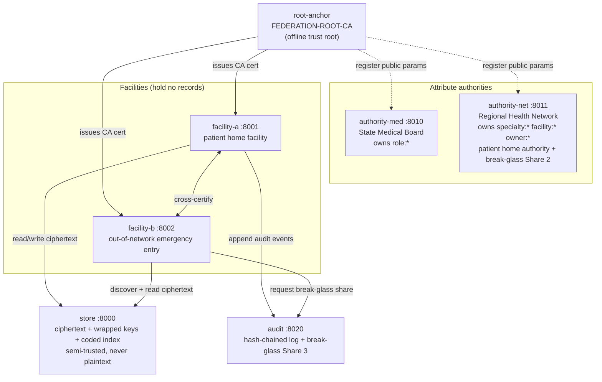

# Federation topology and attribute-authority layout (P0-7)

The concrete "make-believe" federation the system is built and demonstrated
against. It **instantiates** the deployment topology fixed in
[ARCHITECTURE.md §7](../ARCHITECTURE.md) — it does not change it. Naming,
attribute ownership, and the home-authority binding are recorded in
[ADR-0019](adr/0019-federation-topology-and-attributes.md).

> No real patient data, ever. Every person, record, and identifier below is
> synthetic (PROJECT.md §6).

## 1. Overview

A minimal federation that is still enough to exercise the whole thesis: a record
follows the patient across institutions, and an out-of-network clinician can
break glass on an unconscious patient using threshold shares held by parties who
do not trust each other. That needs **two facilities** (home + out-of-network),
**two independent attribute authorities** (so a policy draws attributes from more
than one issuer), **one trust root**, a **shared encrypted store**, and a
separate **audit service**.

## 2. Topology diagram



Trust boundaries (ARCHITECTURE §5): `store` is honest-but-curious and holds no
keys; `audit` is trusted to commit-before-release one share but cannot open a
record alone; facilities hold clinician certs and read ciphertext but **hold no
records**.

## 3. PKI and certificate architecture

Follows the bootstrap order in ARCHITECTURE §7.

- **`root-anchor` (FEDERATION-ROOT-CA)** — the single trust root. Generated first;
  its public key is the anchor every facility validates against. Offline after
  issuance (not a running service).
- **Facility CAs** — `root-anchor` issues a CA certificate to `facility-a` and
  `facility-b`. The two are **cross-certified** so `facility-b` can validate a
  clinician enrolled at `facility-a` — the property the cross-facility break-glass
  scenario depends on.
- **Clinician certificates** — issued under a facility CA; the subject is the
  clinician id. A clinician's certificate key signs their Emergency Assertions
  (contracts `EmergencyAssertion.signature`, ARCHITECTURE §8).
- **Key material** never enters git. Keys and certs live under `deploy/pki/`,
  which is `.gitignore`d in full (ARCHITECTURE §7 "Configuration").

## 4. Attribute ownership matrix

Each authority is authoritative for a disjoint namespace; a leaf in a policy tree
names both the attribute and the `authority_id` that owns it (contracts
`PolicyTree` leaf). Ownership is frozen by [ADR-0019](adr/0019-federation-topology-and-attributes.md).

| Namespace | Owner | Example values |
|---|---|---|
| `role:*` | `authority-med` | `physician`, `nurse`, `surgeon`, `emergency-physician`, `admin` |
| `specialty:*` | `authority-net` | `cardiology`, `trauma`, `pediatrics`, `neurology` |
| `facility:*` | `authority-net` | `facility-a`, `facility-b` |
| `owner:*` | `authority-net` | `<patient_id>` (one per patient; ADR-0016) |

Value spellings match ARCHITECTURE §3 (`role:physician`, `role:emergency-physician`,
`specialty:cardiology`). Attribute values are opaque non-empty identifiers
(contracts `Attribute`), so this list is the agreed taxonomy, not a schema
constraint.

**`authority-net` is the patient home authority.** It issues each patient's
`owner:<patient_id>` attribute *and* holds break-glass Share 2. See ADR-0019 for
the trust-concentration consequence (a rogue `authority-net` could mint an owner
key and contribute Share 2, but still cannot open a record alone — 2 of 3).

Departments (cardiology ward, ER, ICU) are **portal metadata**, not crypto
attributes — they never appear in a policy tree and never gate a key
(consistent with ADR-0014's portals-store-but-never-decide boundary).

## 5. Policy-tree examples

All trees carry the root-level `owner:<patient_id>` OR-leaf so the patient can
always self-decrypt (ADR-0016). Below, the clinical branch is shown; the implicit
`OR owner:<patient_id>` (issued by `authority-net`) wraps each root.

**Routine cardiology access**
```
OR
├── owner:pat-101                         (authority-net)   ← patient self-access
└── AND
    ├── role:physician                    (authority-med)
    └── specialty:cardiology              (authority-net)
```

**Emergency access**
```
OR
├── owner:pat-101                         (authority-net)
├── AND (routine, as above)
└── role:emergency-physician              (authority-med)
```
`role:emergency-physician` satisfies the tree alone — the out-of-network
break-glass path — but reconstructing the emergency *key* still requires the
2-of-3 Shamir gate and a committed audit entry (ARCHITECTURE §5). Policy
satisfaction and the threshold gate are separate checks; both run.

**Patient self-access** — the `owner:pat-101` leaf alone satisfies every one of
the patient's records (ADR-0016).

## 6. Synthetic personas (demo)

Synthetic only — no real people or PHI.

| Id | Who | At | Attributes held |
|---|---|---|---|
| `pat-101` | "Alice", the patient | — | `owner:pat-101` (from `authority-net`) |
| `doc-201` | "Dr. Bob", home cardiologist | `facility-a` | `role:physician`, `specialty:cardiology` |
| `doc-301` | "Dr. Carol", ER physician | `facility-b` | `role:emergency-physician` |

Demo arc: Alice's record lives encrypted in `store` under the routine-cardiology
policy (plus her `owner` leaf). Dr. Bob reads it normally at `facility-a`. Alice
arrives unconscious at out-of-network `facility-b`; Dr. Carol has no routine
access, declares an emergency, and break-glass across the federation reconstructs
the emergency key from 2 of 3 shares only after `audit` commits its log entry.

## 7. Where this maps in the build

- Bootstrap order and ports: ARCHITECTURE §7 (unchanged).
- PKI / cross-certification: `identity` (C5), tasks P2-1.
- Attribute issuance under this matrix: `authority` (C6), task P2-2 (incl. the
  `owner:<patient_id>` issuance from `authority-net`).
- Policy trees using these leaves: `policy` (C7), tasks P2-3 / P3-14.
